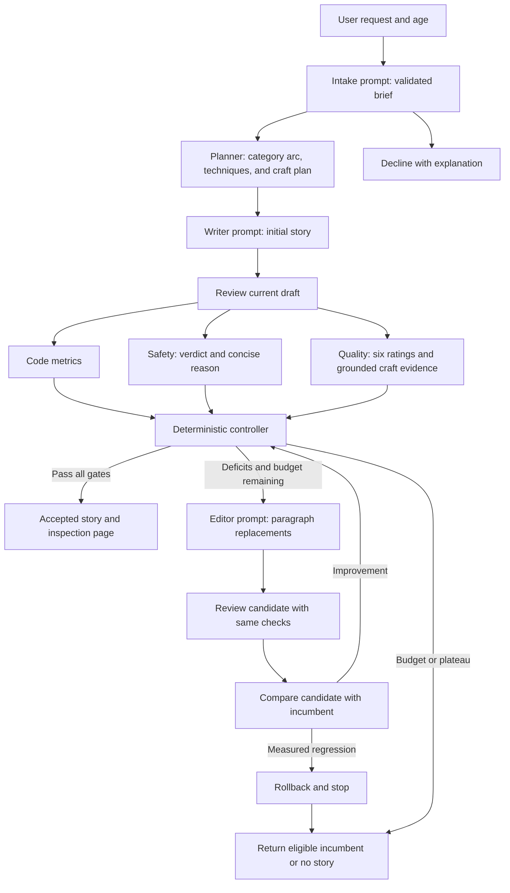
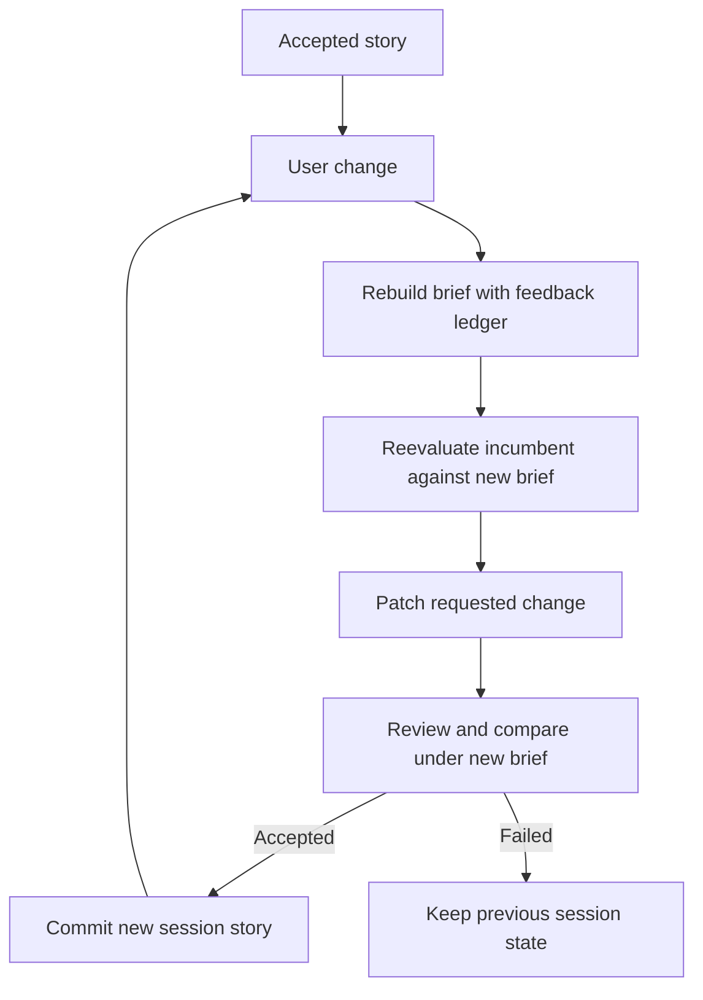

# Architecture

## Generation and refinement

`StoryEngine.run` controls the workflow. Safety and quality run concurrently by default, without seeing each other's verdict, and join before acceptance. Each LLM call uses the required model. JSON mode supplies syntax, Pydantic validates the contract, and `review_validation.py` grounds quality citations against the story. One repair is permitted by default. Incomplete reviews cannot pass acceptance.

## User feedback

The ledger is bounded. New age/length requests are interpreted by intake. The old story's scores are invalid for the new brief and are recomputed. Session history is committed only after acceptance. A requested change may still fail; if the reevaluated incumbent passes, it can survive an operational edit failure with a visible warning.

## Boundaries

- Each stage receives the fields it needs; prompts and stories are data, never executable instructions or tool calls.
- Local code controls retries, iteration limits, retention, output release and artifacts.
- Concurrency is limited to the two review calls for the current draft.
- Budgets count actual transport attempts, including retries and JSON repair, using a lock shared by concurrent reviewers.
- No result is released when its required review is missing. A previously eligible incumbent can survive a later operational failure only within its current evaluated request.
